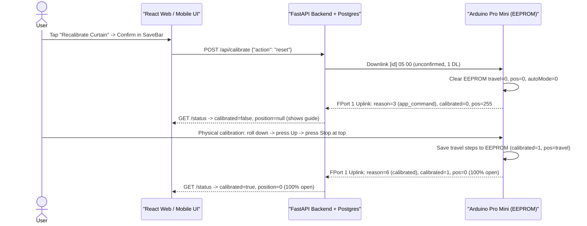

# Proposed Calibration Extension: EEPROM-Stored Travel with Backend-Initiated Recalibration

> **Status:** Architecture & Protocol Proposal (not yet part of finalized [`PROTOCOL_FINAL.md`](PROTOCOL_FINAL.md) or flashed firmware [`smart_curtain.ino`](../firmware/smart_curtain/smart_curtain.ino)).

---

## 1. Design Principle: EEPROM Is the Single Source of Calibration Truth

- The physical stepper mechanism has **no home limit switch**. Travel length (`st.travel` steps) and live step counter (`st.pos`) are measured physically on the Arduino Pro Mini and persisted in **on-chip EEPROM** alongside `st.magic`.
- **The backend database does NOT store step counts.** PostgreSQL only tracks the device-reported boolean (`is_calibrated`) and normalized wire position (`position`: `0–100` `% closed`, or `NULL` when the device sends `255`).
- The backend/UI's role is strictly to **initiate recalibration** (clearing the device's EEPROM calibration remotely over LoRaWAN) and **observe completion** when the user finishes physical calibration at the window.

---

## 2. Proposed LoRaWAN Device API Extension (`FPort 1`, Opcode `5`)

Add a 5th downlink command (`calibrate`) to the `downlinks.commands` map on `FPort 1`:

| Opcode | Name | Wire Format (`>BBB`) | Action Byte Values | Device Effect & Uplink Reply |
|---|---|---|---|---|
| `5` | `calibrate` | `[cmd_id] 05 [action]` | `0x00` = `reset` (clear EEPROM & enter uncalibrated state)<br>`0x01` = `auto_calibrate` *(reserved for future hardware with endstops/stall sensing)* | **On `0x00` (`reset`):**<br>1. Halt motor, set `st.autoMode = 0`, set `calibrating = false`.<br>2. Clear `st.travel = 0`, `st.pos = 0`, write `EEPROM` (`save()`).<br>3. Set `st.lastId = cmd_id` and transmit 4-byte `FPort 1` reply (`reason = 3 app_command`, `flags` with bit 2 `calibrated = 0` & bit 0 `automatic = 0`, `position = 255`).<br>4. Invalid `[action]` (`> 1`, or `0x01` when no hardware endstops exist) responds with `reason = 7 (rejected)`. |

- Uses the standard **`cmd_id` (1–255)** deduplication and **`25 s × 2` unconfirmed handshake**.
- Note: [PROTOCOL_FINAL.md](PROTOCOL_FINAL.md) already defines `FPort 1` uplink `reason = 6` (`"calibrated"`), which the firmware sends automatically once the user completes physical calibration (`roll curtain fully down -> physical Up -> physical Stop at top`).

### Proposed `backend/protocol.json` Addition

```json
"calibrate": {
  "opcode": 5,
  "struct_format": ">BBB",
  "fields": ["cmd_id", "opcode", "action"],
  "action_values": {
    "reset": 0,
    "auto_calibrate": 1
  }
}
```

### Reference Firmware Change (`smart_curtain.ino`, Future Revision)

```cpp
enum { C_POSITION = 1, C_MODE = 2, C_AUTO = 3, C_SCHEDULE = 4, C_CALIBRATE = 5 };

// In downlink():
case C_CALIBRATE: ok = (n == 3 && b[2] == 0); break; // 0 = reset EEPROM travel

case C_CALIBRATE:
  halt();
  calibrating = false;
  st.autoMode = 0;
  st.travel = 0;
  st.pos = 0;
  break; // save() + sendState(R_APP, true) below reports calibrated=0, pos=255
```

---

## 3. Proposed Backend REST API Extension (`POST /calibrate`)

- **Endpoint:** `POST /calibrate` (authenticated Bearer token; exposed behind Nginx at `POST /api/calibrate`).
- **Request Body:** Optional JSON `{"action": "reset"}` (defaults to `{"action": "reset"}` if empty; strict validation returns `400` for unsupported actions or unknown fields).
- **Queue & State Behavior (`Database.enqueue_calibrate`):**
  1. Sets `desired_mode = 'manual'`, `target_position = NULL`, `sync_pending = FALSE` in PostgreSQL.
  2. Marks any `QUEUED` `set_position`, `set_mode`, `set_schedule`, or mode-setting `set_auto_settings` commands as `SUPERSEDED`.
  3. Enqueues `CommandKind.CALIBRATE` (`{"action": "reset"}`) and wakes `dispatch_loop`.
- **Uplink Reconciliation:**
  - When the device replies with `reason = 3 (app_command)`, `is_calibrated = FALSE`, and `position = NULL` (`255` on wire), Postgres persists `is_calibrated = FALSE`, `position = NULL`, and marks `calibrate` as **`CONFIRMED`**.
  - Remote `POST /position` calls immediately return **`409 Conflict` (`{"error": "curtain is not calibrated"}`)** until recalibration completes.
  - When the user finishes calibration via the physical window buttons, the Arduino writes `st.travel` to EEPROM and transmits `reason = 6 (calibrated)`, `is_calibrated = TRUE`, `position = 0` (`100% open`), updating Postgres with **0 extra downlinks**.

---

## 4. End-to-End Flow (REST + LoRaWAN + EEPROM)



---

## 5. Frontend UX & Downlink Budget Notes

- **Placement:** Expose **"Recalibrate Curtain"** on the **Settings (`/settings`)** and **Debug (`/debug`)** screens (alongside **Force State Sync**), **never** as a one-tap trigger on the main Control view.
- **Confirm Before Sending:** Tapping **Recalibrate Curtain** opens a confirmation bar (`"Clear saved calibration on the curtain and start physical recalibration? Uses 1 downlink and locks remote moves until calibrated."` · `Cancel` / `Send Recalibration`) matching the rest of the downlink-safe UI.
- **Total Downlink Cost:** **1 downlink** to initiate (`[id] 05 00`), **0 downlinks** when physical calibration finishes. *(Once recalibrated, switching back to `Automatic` sends at most 1 Type 3 downlink if rules aren't yet synced.)*
